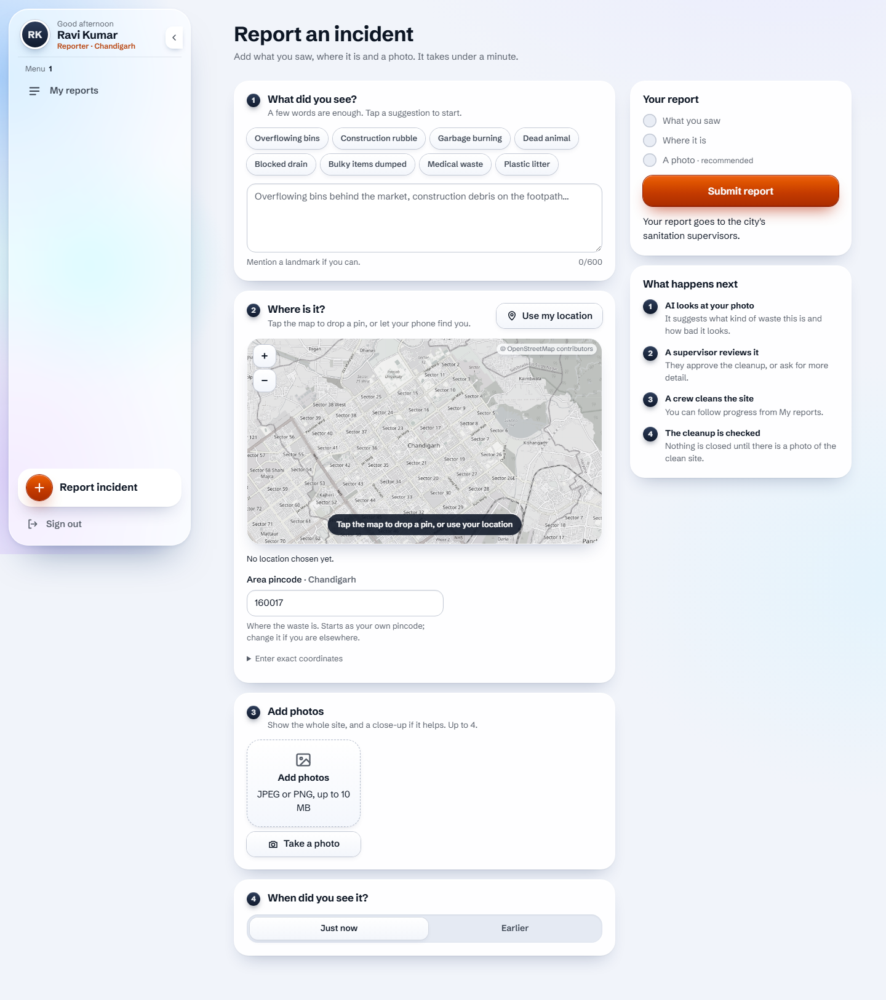
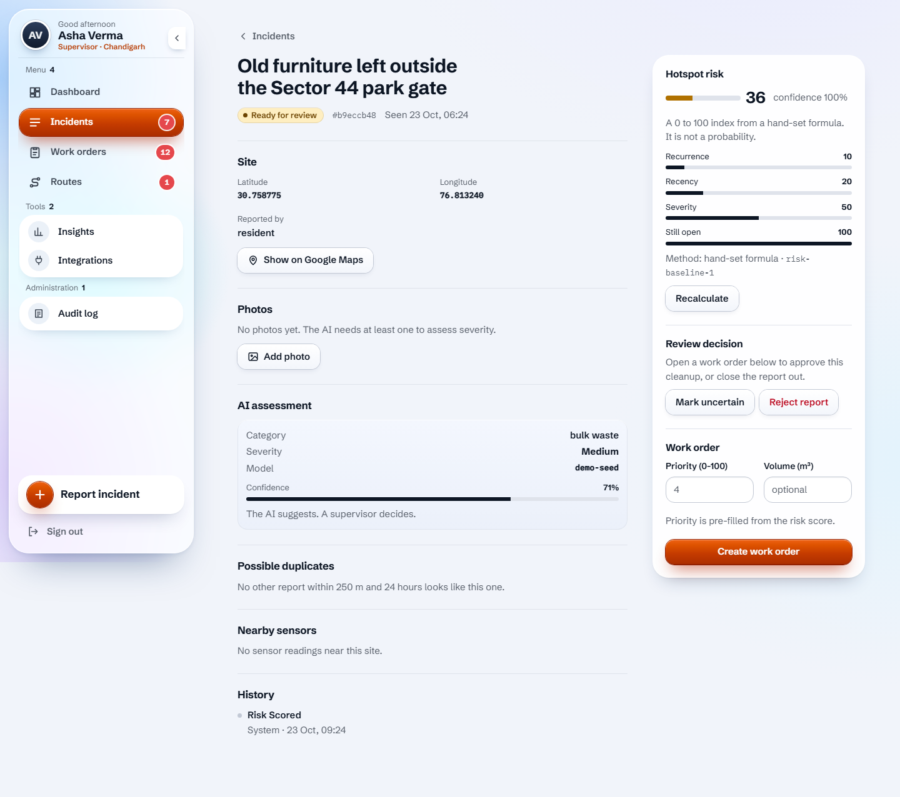
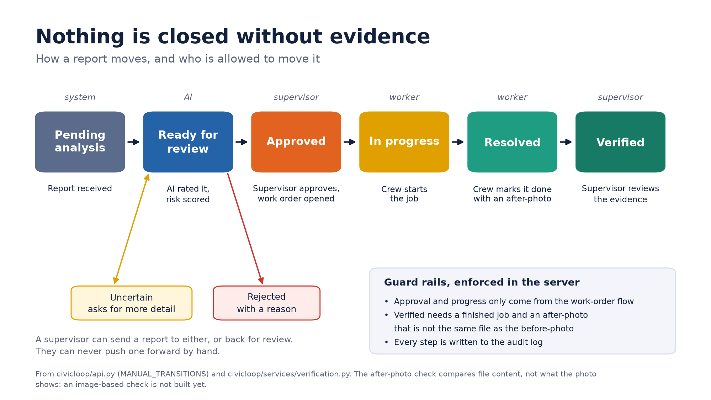
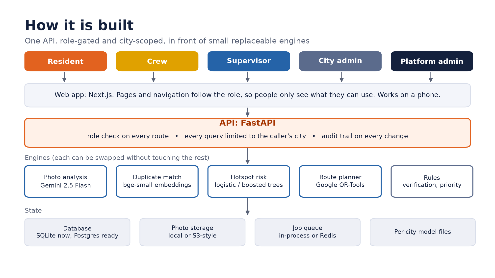

<div align="center">

# CivicLoopAI

**Clean the right street first.**
A human-supervised waste-management workflow for Indian cities: report, understand, prioritise, route, verify, learn.

`Next.js 16` · `FastAPI` · `SQLAlchemy` · `Gemini 2.5 Flash` · `Google OR-Tools` · `bge-small embeddings` · `multi-city`

</div>

---

## Contents

1. [What it is](#1-what-it-is)
2. [See it](#2-see-it)
3. [How a report moves](#3-how-a-report-moves)
4. [Who can do what](#4-who-can-do-what)
5. [Quick start](#5-quick-start)
6. [Configuration](#6-configuration)
7. [Architecture](#7-architecture)
8. [Many cities, one deployment](#8-many-cities-one-deployment)
9. [AI and machine learning, and how good it really is](#9-ai-and-machine-learning-and-how-good-it-really-is)
10. [Live vehicle tracking](#10-live-vehicle-tracking)
11. [API map](#11-api-map)
12. [Testing](#12-testing)
13. [Project layout](#13-project-layout)
14. [Docs, research and pitch material](#14-docs-research-and-pitch-material)
15. [Honest status and limits](#15-honest-status-and-limits)
16. [Roadmap](#16-roadmap)
17. [Security notes](#17-security-notes)

---

## 1. What it is

Cities collect most of their waste but struggle with what comes after: knowing which complaint matters most, sending a
crew on a sensible round, and **proving the cleanup happened**. CivicLoopAI is the layer that sits on top of a city's
existing complaint channels and does exactly that.

- Residents and crews **report** a site with a photo and a map pin.
- **Gemini** reads the photo and suggests a category and severity. A person always reviews.
- A **hotspot risk score** and repeat-site detection rank the queue.
- Supervisors **approve** work, assign crews, and plan **optimised routes** that pull urgent sites forward.
- Crews finish the job with an after-photo. Nothing is marked **verified** without evidence and a supervisor's review.
- Everything is logged, and outcomes feed the next risk model.

**Principle: the software suggests, people decide.** AI output is never the last word, and every claim in this repo about
what works is labelled with how it was measured. See [section 15](#15-honest-status-and-limits).

It is built for the Chandigarh pilot and is multi-tenant, so any number of cities can share one deployment without seeing
each other's data.

## 2. See it

Full-page screenshots of every page, for every role, are in [`docs/screenshots/`](docs/screenshots/README.md).

| Command center (supervisor) | Route planner |
| --- | --- |
|  |  |

| Report an incident | Incident review |
| --- | --- |
|  |  |

Slides for a pitch (problem, loop, architecture, tenancy, ML scorecard, feasibility, pricing, competitors) are in
[`docs/pitch/`](docs/pitch/README.md).

## 3. How a report moves



```
pending_analysis -> ready_for_review -> approved -> in_progress -> resolved -> verified
                          |   ^
                          v   |
                    uncertain / rejected
```

Guard rails, enforced in the server and covered by tests:

- A supervisor can send a report to **uncertain** or **rejected**, or back for review. They cannot push one forward by hand.
- **Approved, in progress and resolved** only come from the work-order flow.
- **Verified** needs a finished job and an after-photo that is not the same file as the before-photo, then a supervisor's review.
- Every change is written to the audit log.

> The after-photo check compares file content, not what the picture shows. A location and image check is a roadmap item.

## 4. Who can do what

| | Resident | Crew | Supervisor | City admin | Platform admin |
| --- | :-: | :-: | :-: | :-: | :-: |
| Report incidents, upload photos | yes | yes | yes | yes | yes |
| See own reports only | yes | | | | |
| See and open work assigned to them, start and finish jobs | | yes | | | |
| Command-center dashboard, ranked queue, sightings map | | | yes | yes | yes |
| Run AI analysis, approve, assign, override priority | | | yes | yes | yes |
| Plan, preview and approve routes | | | yes | yes | yes |
| Review cleanup evidence | | | yes | yes | yes |
| Duplicates, sensors, municipal import and export, evaluations, pilots | | | yes | yes | yes |
| Audit log | | | yes | yes | yes |
| Manage users, background jobs, train the risk model | | | | yes | yes |
| See every city, confirm or merge cities, step into any city | | | | | yes |

Roles are enforced in the API on every route, not just hidden in the interface. The web app also builds its menu from the
same table, so a link never leads to a locked page.

Only people with the **admin** role listed in `CIVICLOOP_PLATFORM_ADMINS` are platform admins.

## 5. Quick start

**Prerequisites:** Python 3.11+, Node 20+. A Gemini API key if you want real photo analysis (everything else works without).

### Backend

```bash
python -m venv .venv
# Windows: .venv\Scripts\activate      macOS/Linux: source .venv/bin/activate
pip install -e ".[api,ai,ml,migrations,queue,storage,dev]"

cp .env.example .env          # then edit: set GEMINI_API_KEY and a real CIVICLOOP_AUTH_SECRET
uvicorn civicloop.api:app --host 127.0.0.1 --port 8000
```

The first run creates the SQLite database. For a shared database, set `CIVICLOOP_DATABASE_URL` to PostgreSQL and run
`alembic upgrade head`.

### Frontend

```bash
cd frontend
npm install
npm run build && npm run start -- -p 3000     # or: npm run dev
```

The web app proxies `/api/*` to `BACKEND_URL` (default `http://127.0.0.1:8000`), so there is no CORS setup.

Open http://localhost:3000.

### First accounts

1. **Register** at `/register` with your city and pincode. The first person to register a new city can take the **admin**
   role there. After that, only that city's admins can create supervisors, crews and other admins (Users page).
2. For a quick local demo, load a year of clearly-labelled **simulated** history and a Chandigarh demo data set:

```bash
python -m civicloop.ml_tools seed --city Chandigarh      # 1,500 SIMULATED reports for training the risk model
python -m civicloop.demo --city Chandigarh               # sites, work orders and two demo routes
python -m civicloop.ml_tools train --city Chandigarh     # trains the risk model; deploys it only if it beats the formula
```

3. To make yourself a platform admin, put your admin email in `CIVICLOOP_PLATFORM_ADMINS` and restart.

> The accounts used by the browser tests (`admin@civic.test` and friends) exist only in the throwaway test database that
> the test launcher builds. They are not shipped and have no place in a real deployment.

## 6. Configuration

All settings are environment variables. `.env.example` documents every one.

| Variable | Default | What it does |
| --- | --- | --- |
| `CIVICLOOP_DATABASE_URL` | `sqlite:///civicloop.db` | SQLite for development, PostgreSQL for production |
| `CIVICLOOP_AUTH_SECRET` | random per process (dev) | Signs sign-in tokens. **Required in production** (32+ characters). |
| `CIVICLOOP_ENV` | `development` | `production` refuses to start without a secret |
| `CIVICLOOP_TOKEN_TTL_SECONDS` | `43200` | Sign-in lifetime (12 hours) |
| `CIVICLOOP_AI_PROVIDER` | unset | `gemini` or `open_weight`. Unset disables AI analysis. |
| `GEMINI_API_KEY`, `GEMINI_MODEL` | | Photo analysis with Gemini (default `gemini-2.5-flash`) |
| `OPEN_WEIGHT_ENDPOINT`, `OPEN_WEIGHT_MODEL` | | Any OpenAI-compatible server (vLLM, Ollama, ...) |
| `CIVICLOOP_STORAGE_BACKEND` | `local` | `local`, `memory` or `s3` (also R2, MinIO) |
| `CIVICLOOP_QUEUE_BACKEND` | `memory` | `redis` for a separate worker (`python -m civicloop.worker`) |
| `CIVICLOOP_MODEL_DIR` | `./var/models` | Trained risk models, one sub-folder per city |
| `CIVICLOOP_EMBEDDINGS` | on | `off` skips the embedding model download |
| `CIVICLOOP_PLATFORM_ADMINS` | empty | Comma-separated admin emails who can manage all cities |
| `BACKEND_URL` | `http://127.0.0.1:8000` | Where the web app proxies `/api` |

## 7. Architecture



- **Web:** Next.js 16 (App Router), React 19, plain CSS. The map is a hand-built SVG slippy map on OpenStreetMap tiles.
- **API:** FastAPI. Every route is role-checked, and every database query is limited to the caller's city.
- **Engines:** small, replaceable modules (`civicloop/engines`, `civicloop/ai.py`, `civicloop/embeddings.py`, `civicloop/risk_model.py`).
- **State:** SQLAlchemy models, Alembic migrations, pluggable photo storage and job queue.
- **Background jobs:** AI analysis runs off the request path, in-process by default or on Redis with a separate worker.

## 8. Many cities, one deployment


Every row belongs to a city. One rule in one place (`civicloop/tenancy.py`) filters every read and stamps every write, so
no route has to remember it. A request can never see or change another city's data, and background jobs inherit the city
of the report they work on. Each city trains and deploys its own risk model, and photos are stored under a per-city prefix.

- **Registration** takes a city and a six-digit pincode. A city that does not exist yet is created, **unconfirmed**.
- **Unconfirmed cities** work normally but are kept out of the public suggestions until a platform admin confirms them or
  merges a misspelling into the right city.
- **Platform admins** get a Cities page and a "Working in" switcher.
- The isolation is covered by 18 dedicated tests (`tests/test_tenancy.py`).

## 9. AI and machine learning, and how good it really is

| Component | Method | Measured on | Result |
| --- | --- | --- | --- |
| Photo analysis | Gemini 2.5 Flash, zero-shot | **Nothing.** No labelled photos exist. | Unknown |
| Hotspot risk | Logistic regression or boosted trees; deployed only if it beats the formula by 0.01 AUC | 10 **simulated** cities, newest 30% held out | AUC 0.65 (formula) to 0.67 (model); clearly better in 5 of 10 |
| Duplicate reports | `bge-small-en-v1.5` sentence embeddings | 40 **hand-written** description pairs | AUC 0.89 vs 0.49 for word overlap; recall 95%, precision 70% |
| Routes | Google OR-Tools, guided local search | Random layouts vs nearest-stop-next | 8% to 16% shorter, urgent stops reached earlier |


**There is no real dataset yet.** Every number above comes from simulated or hand-written data, and the interface labels
simulated history as simulated. Route savings are straight-line distances on random layouts, not real roads.

Read the full method, figures and caveats in [`docs/ml_report/`](docs/ml_report/README.md). Regenerate with
`python scripts/ml_report.py`.

## 10. Live vehicle tracking

Where each collection vehicle is, from either a crew phone or a hardware GPS tracker.

**Status:** the backend is complete and tested (`tests/test_fleet.py`, 11 tests). The web pages (a live fleet map for
supervisors and a "share my location" card for crews) are **still being built**.

What exists today:

- **Vehicles** (per city): label, registration, assigned driver, on or off, and a private tracker key.
- **Two ways in:**
  - A crew phone posts a fix as the signed-in driver: `POST /api/v1/vehicles/{id}/position`.
  - A GPS tracker posts with its key, no login: `POST /api/v1/telemetry/gps` with an `X-Device-Key` header. It accepts one
    fix or a batch (up to 200) from a tracker that buffered while out of signal.
- **Plausibility checks.** A fix is dropped if it is outside valid coordinates, more than 5 minutes in the future, older than
  24 hours, too vague (over 500 m), or implies a speed no truck can reach (over 160 km/h) between two fixes.
- **State** worked out on the server: `moving`, `idle`, `stale` (no fix for 2 minutes), `offline` (10 minutes), `no_signal`.
- **Speed and distance today** are derived when a tracker sends only a position.
- **History** keeps one fix every few seconds for 7 days.
- **Keys** are stored as hashes, shown once, and can be rotated. Switching a vehicle off, or disabling its city, stops it at once.
- **Demo simulator:** `python -m civicloop.gps_sim --email <supervisor> --password <pw> --vehicles 4` drives demo trucks in
  straight lines between sites and reports through the real tracker endpoint. Simulated, not road-following.

Example tracker call:

```bash
curl -X POST http://127.0.0.1:8000/api/v1/telemetry/gps \
  -H "X-Device-Key: clv_..." -H "Content-Type: application/json" \
  -d '{"lat": 30.7333, "lon": 76.7794, "speed_kmh": 24, "heading": 90, "recorded_at": "2026-10-23T09:30:00+00:00"}'
```

## 11. API map

Interactive docs are served by FastAPI at `/docs`. Everything is under `/api/v1`.

| Area | Routes (examples) |
| --- | --- |
| Auth and identity | `POST /auth/register`, `POST /auth/login`, `GET /auth/me`, `GET /tenants?q=`, `GET /me/badges` |
| Incidents | `POST/GET /incidents`, `GET /incidents/{id}`, `PATCH /incidents/{id}/status`, `POST/GET /incidents/{id}/media` |
| AI and risk | `POST /incidents/{id}/analysis`, `GET/POST /incidents/{id}/risk`, `GET /ml/status`, `POST /ml/risk/train` |
| Review | `GET /queue`, `GET /incidents/{id}/timeline`, `.../duplicates`, `.../override`, `.../sensors` |
| Work | `POST /incidents/{id}/work-orders`, `GET /work-orders`, `POST /work-orders/{id}/approve|assign|start|complete` |
| Routes | `POST /routes/preview`, `POST /routes`, `GET /routes/{id}`, `POST /routes/{id}/approve` |
| Verification | `POST /incidents/{id}/verification`, `POST /verification/{id}/review` |
| Dashboard | `GET /dashboard/summary`, `GET /dashboard/map` |
| Fleet | `GET/POST /vehicles`, `PATCH /vehicles/{id}`, `POST /vehicles/{id}/device-key`, `GET /vehicles/{id}/trail`, `POST /telemetry/gps` |
| Integrations | `POST /municipal/export|import`, `GET/POST /sensors/readings`, `/evaluations`, `/pilots` |
| Admin | `GET/PATCH /users`, `GET /audit`, `GET /jobs`, `/platform/cities` (platform admins) |

## 12. Testing

```bash
pytest -q                 # 86 backend tests: auth, roles, cleanup loop, ML, dashboard, tenancy, fleet
cd frontend
npm run lint && npx tsc --noEmit
npm run e2e               # Playwright journey across all roles; see the note below
```

The browser suite signs in as every role, walks the full cleanup loop on a throwaway backend, checks every page for
horizontal scroll on a phone, and fails on any console error or server error. It expects a running backend and frontend
and two sample photos (`BEFORE_PNG`, `AFTER_PNG`). The steps that call Gemini fail when the API quota is exhausted.

`node e2e/screenshots.mjs ../docs/screenshots` regenerates the screenshots.

## 13. Project layout

```
civicloop/                 backend package
  api.py                   app factory, auth, registration, incidents, media
  routes_ops.py            role-gated operations routes (work orders, routes, review, dashboard, admin, platform)
  routes_fleet.py          live vehicle tracking routes
  tenancy.py               per-city read filter and write stamping
  models.py  repositories.py  db.py
  services/                one service per domain (incident, work_order, route_planning, fleet, dashboard, ...)
  engines/                 deterministic engines: routing (OR-Tools + greedy), duplicates, risk formula
  ai.py  embeddings.py  risk_model.py  synthetic.py  ml_tools.py
  jobs.py  worker.py  job_handlers.py   background analysis queue and worker
  demo.py  gps_sim.py      demo data and the GPS simulator
migrations/                Alembic revisions (0001 to 0005)
tests/                     pytest suite
frontend/                  Next.js app (src/app pages, src/components, src/lib, e2e/)
scripts/                   ml_report.py, pitch_figures.py, pitch_figures_market.py
docs/                      FMEA, ML report, screenshots, pitch and market research
```

## 14. Docs, research and pitch material

| Where | What |
| --- | --- |
| [`docs/ml_report/`](docs/ml_report/README.md) | Models, datasets, accuracy, figures, caveats |
| [`docs/pitch/`](docs/pitch/README.md) | Eleven slides with talking points and sources |
| [`docs/pitch/market-and-pricing.md`](docs/pitch/market-and-pricing.md) | Market research, feasibility ranking, B2B vs B2G, subscription pricing and why |
| [`docs/pitch/competitors.md`](docs/pitch/competitors.md) | Who else is in this space, threat ranking, our gaps |
| [`docs/screenshots/`](docs/screenshots/README.md) | Every page, every role, desktop and phone |
| [`docs/FMEA.md`](docs/FMEA.md) | Failure modes and the fixes made |
| `plan.md`, `route_plan.md`, `service.md`, ... | Original design notes |

Headlines from the research: collection is largely solved on paper (92% nationally) but processing is not (54%), and
Chandigarh reports collecting everything yet processing about 15% (CPCB 2021-22). The recommended path is B2B first
(contractors and bulk-waste-generator compliance), with a no-fee city pilot as proof. A city-licence price of
Rs 1 lakh plus Rs 250 per vehicle per month is estimated to pay for itself at a 1 to 2% saving. These are estimates built on
stated assumptions; read the documents before quoting any of them.

## 15. Honest status and limits

- **No real-world data yet.** All model results are simulated or hand-written. Gemini photo analysis is unmeasured.
- **The after-photo check is file-based.** It does not look at the image or its location.
- **Routes use straight-line distance**, not road distance or live traffic.
- **No hardware integrations beyond GPS.** No RFID, bin sensors or weighbridge. A sensor reading can be recorded and
  associated with a report manually.
- **Municipal integration is manual:** export and import, not a live link to a city's system.
- **English only.** No Hindi or other languages yet.
- **No native mobile app and no offline mode.** The web app is responsive and works on a phone browser.
- **Live tracking UI is in progress** (see section 10).
- **Free third-party limits:** Gemini has a quota; OpenStreetMap tiles are for light use and need a proper tile provider at scale.
- **No licence has been chosen.**

## 16. Roadmap

1. Finish the live fleet map and crew location sharing in the web app.
2. Location-based closure: match the after-photo to the report's place, as Bengaluru's pilot does.
3. Accept a GPS feed from a city's existing tracking vendor.
4. Run an 8-week pilot in one ward and measure time-to-clear and repeat-site rate on real reports.
5. Hand-label about 300 photos to measure the AI honestly; retrain the risk model on real history.
6. Bulk-generator compliance features (registration reminders, segregation logs, audit-ready records).
7. Road-distance routing and an image-based cleanup check.

## 17. Security notes

- Passwords are hashed with scrypt. Sign-in tokens are HMAC-signed and short-lived; the database, not the token, decides a
  person's role and whether they are active.
- Every route checks the role, and every query is city-scoped. A reporter only ever sees their own reports.
- Tracker keys are stored as SHA-256 hashes, shown once, and revocable.
- Uploads are limited to images up to 10 MB.
- Set a real `CIVICLOOP_AUTH_SECRET` and `CIVICLOOP_ENV=production` before exposing the API. Without a secret in development,
  a random one is generated per process and sign-ins do not survive a restart.
- **Never commit `.env`.** It holds your API keys and is excluded from version control and from the project zip.
- Anyone can register a new city and become its first admin. That is the self-service design; the platform admin confirms
  real cities, and a misspelt one is harmless but should be merged.

---

<div align="center">

Built for the Chandigarh pilot. Suggests, never decides.

</div>
