<div align="center">

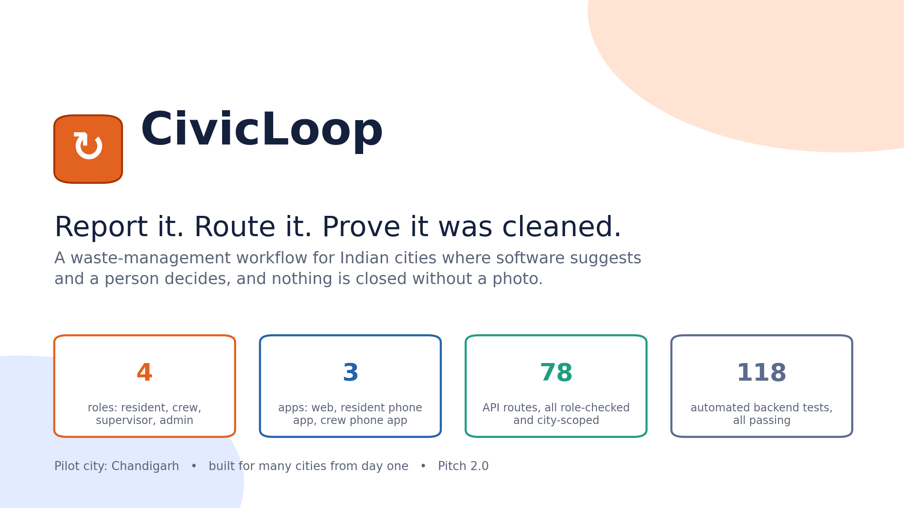

# CivicLoopAI

**Clean the right street first.**
A human-supervised waste-management workflow for Indian cities: report, understand, prioritise, assign, route, track, verify, learn.


**AI suggests. People decide. Nothing is closed without a photo.**

[Quick start](#6-quick-start) · [Deploy the backend](backend/README.md#deploy-on-render) · [Run on your phone](#63-use-the-phone-apps-without-deploying-anything) · [Architecture](#9-architecture) · [Security and reliability](#11-security-and-reliability) · [Honest limits](#17-honest-status-and-limits)

</div>

---

## Contents

1. [What it is](#1-what-it-is)
2. [See it](#2-see-it)
3. [How the work flows](#3-how-the-work-flows)
4. [One route belongs to one driver](#4-one-route-belongs-to-one-driver)
5. [Who can do what](#5-who-can-do-what)
6. [Quick start](#6-quick-start)
7. [Configuration](#7-configuration)
8. [Mobile apps](#8-mobile-apps)
9. [Architecture](#9-architecture)
10. [Many cities, one deployment](#10-many-cities-one-deployment)
11. [Security and reliability](#11-security-and-reliability)
12. [AI and machine learning, and how good it really is](#12-ai-and-machine-learning-and-how-good-it-really-is)
13. [Live vehicle tracking](#13-live-vehicle-tracking)
14. [API map](#14-api-map)
15. [Testing](#15-testing)
16. [Project layout](#16-project-layout)
17. [Honest status and limits](#17-honest-status-and-limits)
18. [Roadmap](#18-roadmap)
19. [Docs, research and pitch material](#19-docs-research-and-pitch-material)
20. [Recording the demo video](#20-recording-the-demo-video)
21. [Troubleshooting](#21-troubleshooting)

---

## 1. What it is

Cities collect most of their waste but struggle with what comes after: knowing which complaint matters most, sending a
crew on a sensible round, and **proving the cleanup happened**. CivicLoopAI is the layer that sits on top of a city's
existing complaint channels and does exactly that.

| | |
| --- | --- |
| **Report** | Residents and crews send a photo and a map pin, from the web or a phone app. |
| **Understand** | Gemini reads the photo and suggests a category and severity. A hotspot risk score and repeat-report detection rank the queue. A person always reviews. |
| **Decide** | A supervisor approves the work, overrides priority (with a reason), and assigns it to **one named driver**. |
| **Route** | The planner orders that driver's jobs with Google OR-Tools, pulling urgent sites forward. Approving the route **sends it to the driver automatically**. |
| **Drive and track** | The driver sees the route in their app, opens it in Google Maps for live directions, and shares the vehicle's position so the control room sees it live. |
| **Prove** | The driver finishes with an after-photo. Nothing becomes **verified** without evidence and a supervisor's review. |
| **Learn** | Every step is in the audit log, and outcomes feed the next risk model, per city. |

**Principle: the software suggests, people decide.** AI output is never the last word, and every claim in this repository about
what works says how it was measured. See [section 17](#17-honest-status-and-limits).

Built for the Chandigarh pilot and multi-tenant from day one, so any number of cities can share one deployment without
seeing each other's data.

**At a glance**

| | |
| --- | --- |
| Surfaces | Web console, resident phone app, crew phone app, GPS tracker endpoint |
| Roles | Resident, driver (crew), supervisor, city admin, platform admin |
| Backend | FastAPI, 78 routes, all role-checked and city-scoped |
| Tests | 121 backend tests, 15 + 5 phone-app tests, a browser suite across every role |
| Database | SQLite for development, PostgreSQL-ready, 7 migrations that build the schema from an empty database |
| Risk review | A written failure-mode analysis of the whole codebase, 37 findings, fixes recorded in [`docs/FMEA.md`](docs/FMEA.md) |

## 2. See it

### The product

| Command center (supervisor) | Route planner: one driver at a time |
| --- | --- |
| 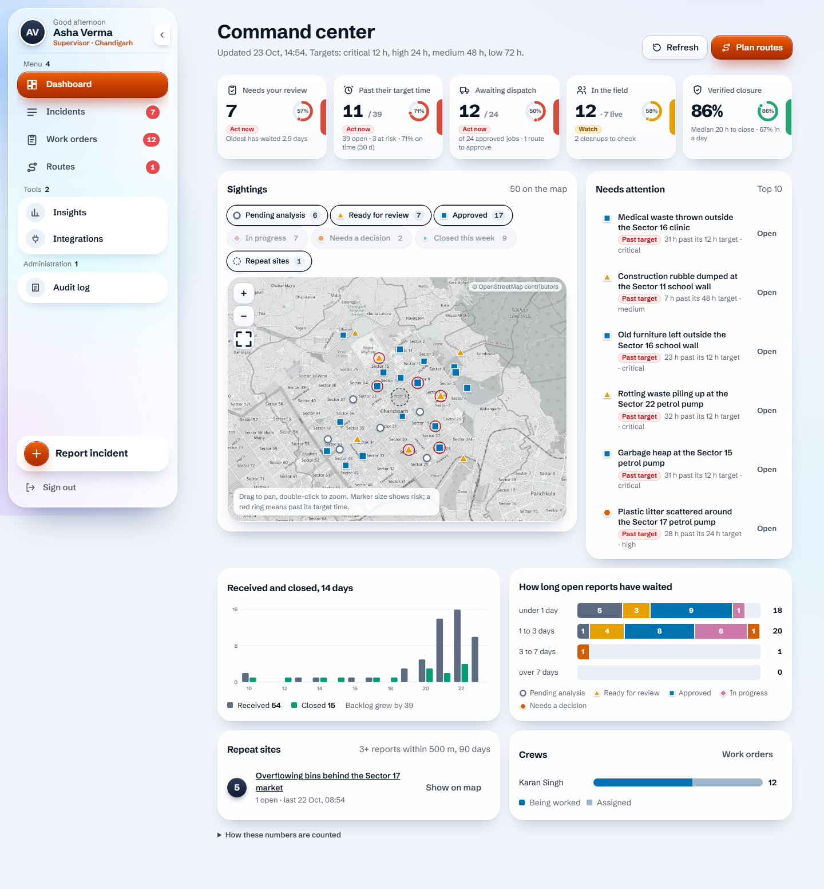 | 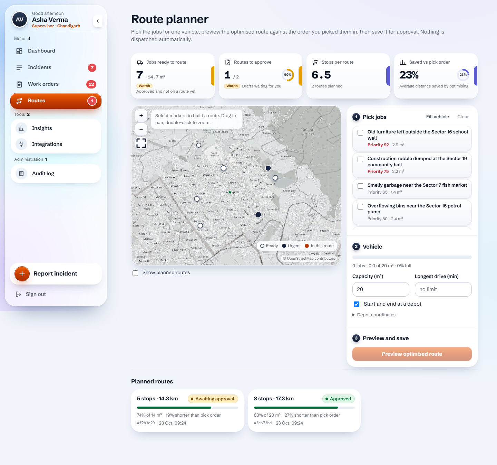 |

| Live fleet | Approved route, sent to the driver |
| --- | --- |
| 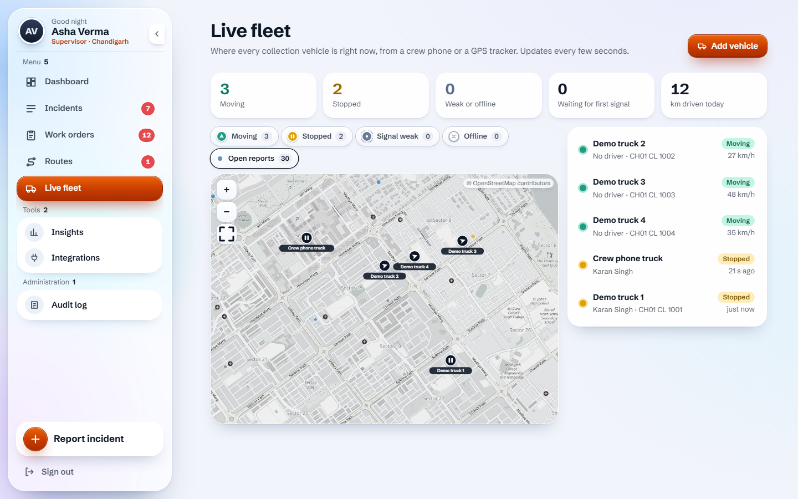 | 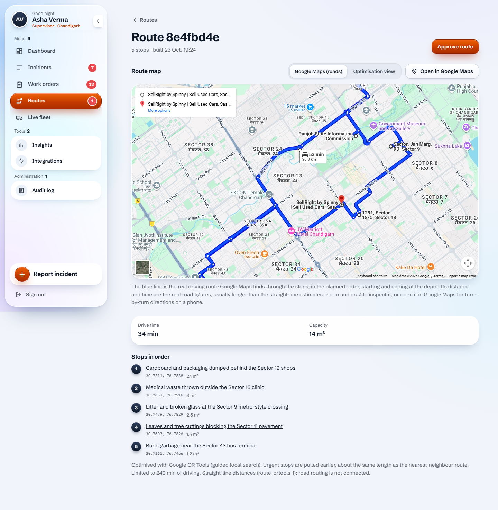 |

Every page for every role: [`docs/screenshots/`](docs/screenshots/README.md).

### The phone apps

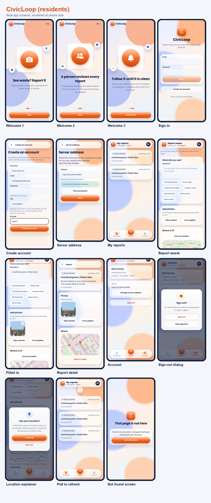

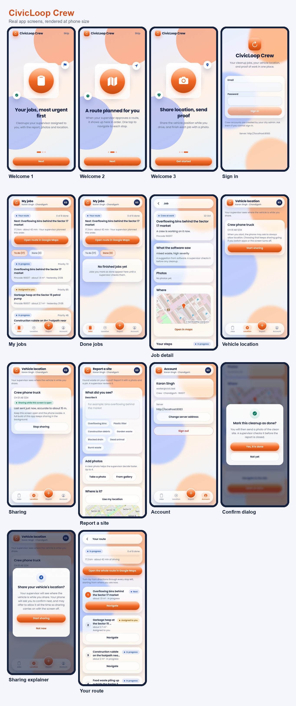

All screens: [`docs/mobile/`](docs/mobile/README.md). These are the apps' web builds in a phone-sized browser, not photos of a handset.

### Pitch 2.0

Twenty-five 16:9 slides (flow charts, status trails, route maps, live tracking, security layers, roles, product tours,
reliability, model scorecard, market, pricing, competitors, pilot plan, roadmap) are in [`docs/pitch2/`](docs/pitch2/).

| The journey | Who does what | One route per driver |
| --- | --- | --- |
| 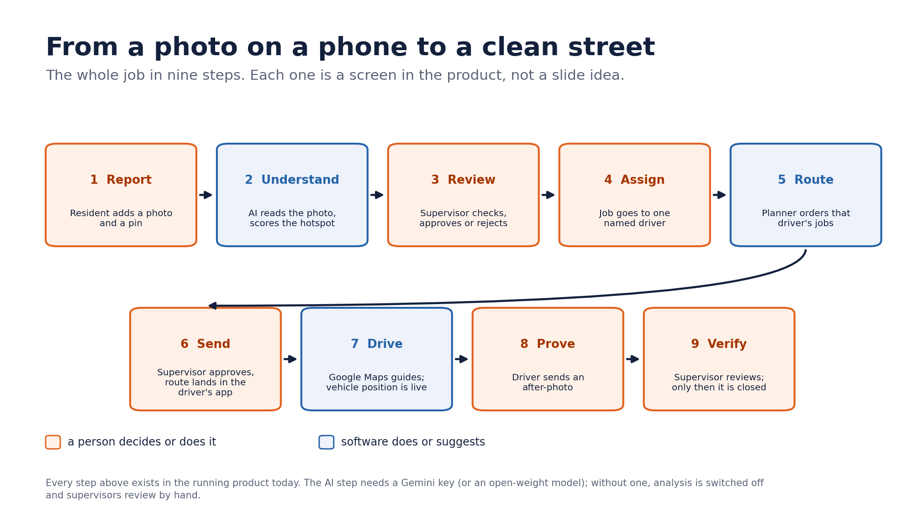 | 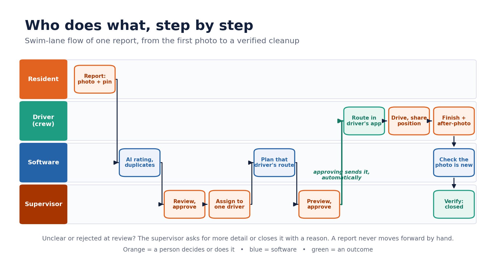 | 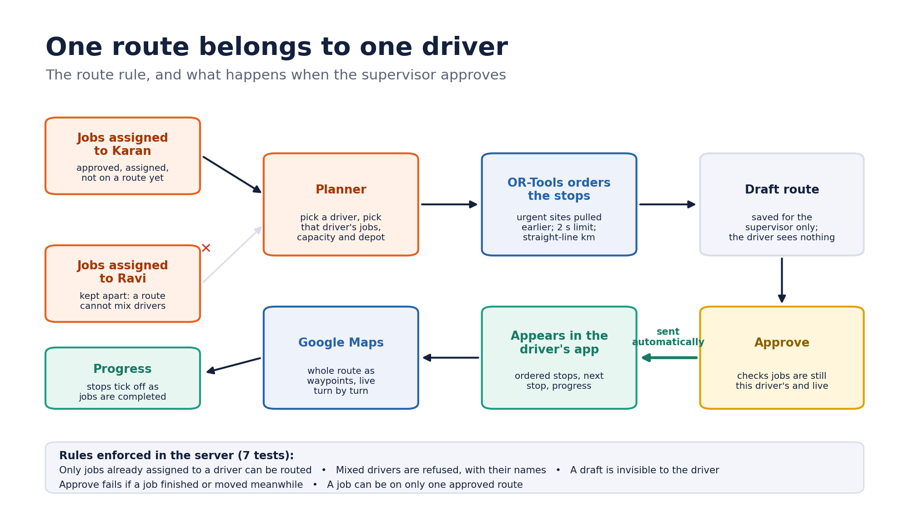 |

## 3. How the work flows

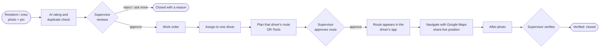

Three status trails, all guarded by the server ([`docs/pitch2/04_status_trails.png`](docs/pitch2/04_status_trails.png)):

```
Report      pending_analysis -> ready_for_review -> approved -> in_progress -> resolved -> verified
                                   |     ^
                                   v     |
                             uncertain / rejected

Work order  draft -> approved -> assigned -> in_progress -> completed        (cancelled at any live step)

Route       draft -> approved (= sent to the driver) -> stops done as jobs finish -> route closes itself
```

Guard rails, enforced in the server and covered by tests:

- A supervisor can send a report to **uncertain** or **rejected**, or back for review. They cannot push one forward by hand.
- **Approved, in progress and resolved** only come from the work-order flow.
- **Verified** needs a finished job and an after-photo that is not the same file as the before-photo, then a supervisor's review.
- An incident can have only one live work order at a time. The database enforces it with a unique index.
- A municipal status import can only make moves the work flow allows. It cannot jump a draft to completed.
- Every change is written to the audit log.

> The after-photo check compares file content, not what the picture shows. An image-based check is a roadmap item.

## 4. One route belongs to one driver

A route is one driver's round. This rule is enforced in the API, shown in the web planner, and respected by the phone apps.

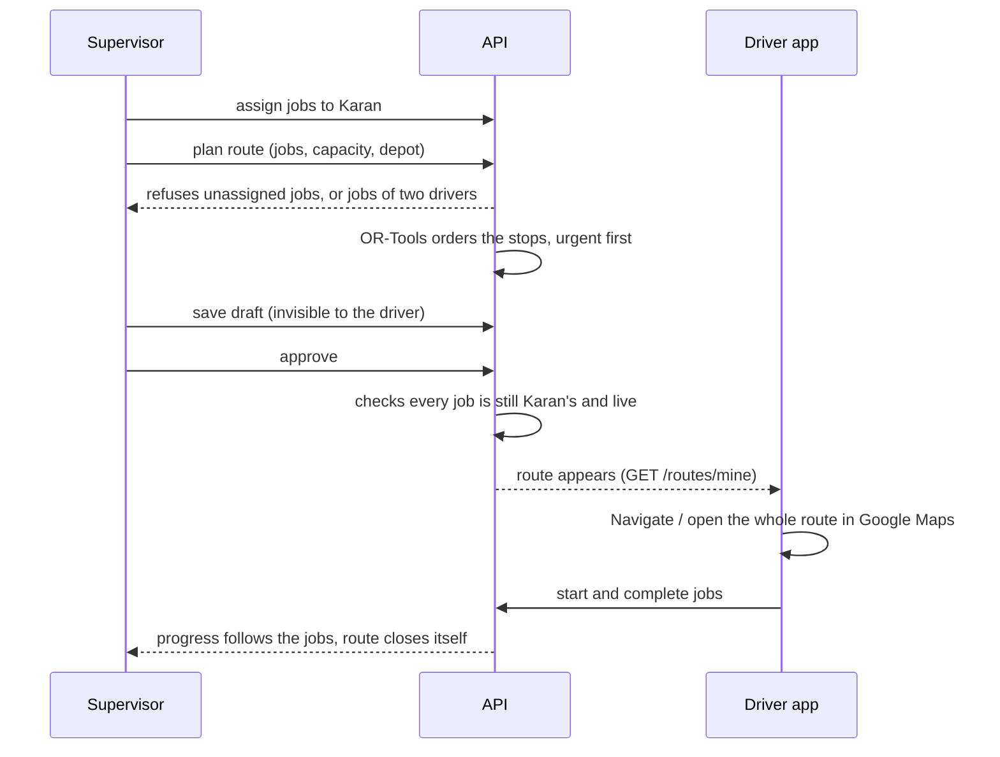

- Only jobs **already assigned to a driver** can be put on a route, and a route cannot mix drivers (the error names them).
- A saved route is a **draft** that only supervisors see. **Approving sends it** to the driver, with no extra step.
- Approving fails with a clear message if a job finished or moved to someone else since planning, or is on another approved route.
- Drivers get `GET /routes/mine`. A driver can open a route only if it is theirs and approved.
- The driver's app shows the stops in order, the next stop highlighted, progress, a **Navigate** button per stop, and one button
  that opens the **whole remaining route in Google Maps** as waypoints from where they are, for live turn-by-turn directions
  (Google Maps takes 10 stops at a time, so a longer route opens in legs).

## 5. Who can do what

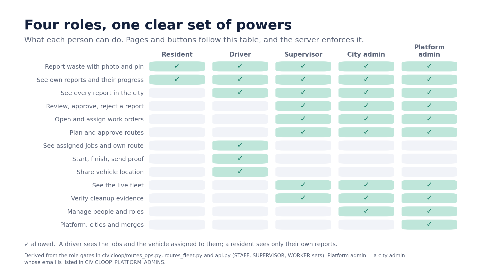

| | Resident | Driver | Supervisor | City admin | Platform admin |
| --- | :-: | :-: | :-: | :-: | :-: |
| Report incidents, upload photos | yes | yes | yes | yes | yes |
| See own reports and their progress | yes | yes | yes | yes | yes |
| See every report in the city | | yes | yes | yes | yes |
| Review, approve, reject; run AI analysis | | | yes | yes | yes |
| Open and assign work orders, override priority | | | yes | yes | yes |
| Plan, preview and approve routes | | | yes | yes | yes |
| See assigned jobs and **own route**, start and finish jobs, send proof | | yes | | | |
| Share the vehicle's phone GPS | | yes | | | |
| Live fleet map, vehicles, tracker keys | | | yes | yes | yes |
| Verify cleanup evidence | | | yes | yes | yes |
| Duplicates, sensors, municipal import and export, evaluations, pilots, audit log | | | yes | yes | yes |
| Manage users and roles, background jobs, train the risk model | | | | yes | yes |
| See every city, confirm or merge cities, step into any city | | | | | yes |

Roles are enforced in the API on every route, not just hidden in the interface. The web app builds its menu from the same table.
A **platform admin** is a city admin whose email is listed in `CIVICLOOP_PLATFORM_ADMINS`.

## 6. Quick start

**Prerequisites:** Python 3.11+, Node 20+ for the web app (Node **22+** for the phone apps), and optionally a Gemini API key
for real photo analysis. Everything else works without it.

### 6.1 Backend

The backend uses [uv](https://docs.astral.sh/uv/) (`pip install uv` once). `uv sync` builds the environment from `uv.lock`; put `uv run` in front of a command to use it, with nothing to activate.

```bash
cd backend
uv sync

cp .env.example .env          # then edit: set GEMINI_API_KEY and a real CIVICLOOP_AUTH_SECRET
uv run uvicorn civicloop.api:app --host 127.0.0.1 --port 8000
```

The first run creates the SQLite database. For a shared database, set `CIVICLOOP_DATABASE_URL` to PostgreSQL and run
`uv run alembic upgrade head`. In production the API refuses to start if the database is not at the latest migration.

**Create the first administrator** from the command line. An address listed in `CIVICLOOP_PLATFORM_ADMINS` cannot be
claimed through the sign-up form, which is how the first platform admin is made:

```bash
# from backend/
CIVICLOOP_PLATFORM_ADMINS=admin@civic.test \
CIVICLOOP_ADMIN_PASSWORD='admin-pass-12345' \
uv run python -m civicloop.make_admin --email admin@civic.test --name "Meera Admin" --city Chandigarh --pincode 160017
```

**Load demo data** (clearly labelled as simulated or demo):

```bash
# from backend/
uv run python -m civicloop.ml_tools seed --city Chandigarh   # 1,500 SIMULATED reports for training the risk model
uv run python -m civicloop.demo --city Chandigarh            # sites, work orders and two demo routes
uv run python -m civicloop.ml_tools train --city Chandigarh  # trains the risk model; deploys it only if it beats the formula
```

### 6.2 Web app

```bash
cd frontend
npm install
npm run build && npm run start -- -p 3000     # or: npm run dev
```

Open http://localhost:3000. The web app sends `/api/v1/*` to `BACKEND_URL` (default `http://127.0.0.1:8000`) through its own
proxy route (`frontend/src/app/api/v1/[...path]/route.ts`). That proxy keeps the sign-in token in an **httpOnly cookie**, so
scripts running in the page cannot read it, and it refuses cross-site writes. There is no CORS setup.

### Demo accounts

Dummy accounts for trying the product. They exist only after you create them (the admin with the command above; the others on
the website's Users page, or by signing up for a resident):

| Role | Email | Password |
| --- | --- | --- |
| City admin and platform admin | `admin@civic.test` | `admin-pass-12345` |
| Supervisor (Asha Verma) | `supervisor@civic.test` | `supervisor-pass-123` |
| Driver / crew (Karan Singh) | `worker@civic.test` | `worker-pass-123456` |
| Resident | `resident@civic.test` | `resident-pass-1234` |

Give the driver a vehicle on the **Live fleet** page so the Location tab works. These are throwaway credentials for local
demos and tests. They have no place in a real deployment.

### First accounts in a real deployment

Register at `/register` with a city and pincode. The first person to register a new city can take the **admin** role there.
After that, only that city's admins can create supervisors, drivers and other admins. A platform admin confirms real cities.

### 6.3 Use the phone apps without deploying anything

The backend stays on your computer and the phone talks to it over Wi-Fi.

1. Install **Expo Go** from the Play Store or App Store. You need Node 22 or newer on the computer.
2. Start the backend so the phone can reach it: `cd backend && uv run uvicorn civicloop.api:app --host 0.0.0.0 --port 8000`.
3. Find your computer's address with `ipconfig` (Windows) or `ifconfig` (macOS/Linux), for example `192.168.1.20`.
4. Allow port 8000 through the firewall, or the phone cannot connect.
5. Start an app:

   ```bash
   cd mobile
   npm install
   EXPO_PUBLIC_API_URL=http://192.168.1.20:8000 npm run resident     # or: npm run crew
   # Windows PowerShell:  $env:EXPO_PUBLIC_API_URL="http://192.168.1.20:8000"; npm run resident
   ```
6. Scan the QR code with Expo Go (Android) or the Camera app (iPhone). Phone and computer must be on the same Wi-Fi.
7. If the app cannot reach the server, tap the **Server** line on the sign-in screen and type the address. The app remembers it.

Not on the same Wi-Fi? Expose the backend with a tunnel (for example `cloudflared tunnel --url http://localhost:8000`) and type the
`https://` address it prints. Use demo accounts only, and stop the tunnel when you are done.

More detail, including what needs a development build instead of Expo Go: [`mobile/README.md`](mobile/README.md).

## 7. Configuration

All settings are environment variables. [`backend/.env.example`](backend/.env.example) documents every one. To deploy the backend on Render, follow [`backend/README.md`](backend/README.md#deploy-on-render).

| Variable | Default | What it does |
| --- | --- | --- |
| `CIVICLOOP_DATABASE_URL` | `sqlite:///civicloop.db` | SQLite for development, PostgreSQL for production (`postgres://` and `postgresql://` addresses from Render or Supabase are accepted; for Supabase use the Session pooler address) |
| `CIVICLOOP_DB_POOL_SIZE`, `CIVICLOOP_DB_MAX_OVERFLOW` | `5`, `5` | Connection pool for PostgreSQL; hosted databases allow few connections |
| `CIVICLOOP_AUTH_SECRET` | random per process (dev) | Signs sign-in tokens. **Required in production** (32+ characters). |
| `CIVICLOOP_ENV` | `development` | `production` refuses to start without a secret, with in-memory storage or queue, or on an out-of-date database |
| `CIVICLOOP_TOKEN_TTL_SECONDS` | `43200` | Sign-in lifetime (12 hours) |
| `CIVICLOOP_LOGIN_ATTEMPTS` | `8` | Wrong passwords allowed per address and email in 5 minutes |
| `CIVICLOOP_REGISTER_LIMIT` | `60` | Sign-ups allowed per address per hour |
| `CIVICLOOP_AI_PROVIDER` | unset | `gemini` or `open_weight`. Unset disables AI analysis. |
| `GEMINI_API_KEY`, `GEMINI_MODEL` | | Photo analysis with Gemini (default `gemini-2.5-flash`), with a 30 s timeout |
| `OPEN_WEIGHT_ENDPOINT`, `OPEN_WEIGHT_MODEL` | | Any OpenAI-compatible server (vLLM, Ollama, ...) |
| `CIVICLOOP_STORAGE_BACKEND` | `local` | `local`, `memory` or `s3` (also R2, MinIO). `memory` is refused in production. |
| `CIVICLOOP_QUEUE_BACKEND` | `memory` | `redis` for a separate worker (`python -m civicloop.worker`). `memory` is refused in production unless `CIVICLOOP_ALLOW_SINGLE_PROCESS=1`. |
| `CIVICLOOP_ALLOW_SINGLE_PROCESS` | unset | `1` lets one production API process use the in-process queue (jobs are re-queued from the database after a restart) |
| `CIVICLOOP_MODEL_DIR` | `./var/models` | Trained risk models, one sub-folder per city |
| `CIVICLOOP_EMBEDDINGS` | on | `off` skips the embedding model download |
| `CIVICLOOP_PLATFORM_ADMINS` | empty | Comma-separated admin emails who can manage all cities (and cannot be claimed by sign-up) |
| `CIVICLOOP_ADMIN_PASSWORD` | | Read by `python -m civicloop.make_admin` (or it asks at a prompt) |
| `BACKEND_URL` | `http://127.0.0.1:8000` | Where the web app's proxy sends `/api/v1` |
| `EXPO_PUBLIC_API_URL` | unset | Default server address for the phone apps |
| `CIVICLOOP_ALLOW_HTTP` | unset | Build-time: lets an Android development build use a plain `http://` server on your Wi-Fi |

## 8. Mobile apps

Two Expo (React Native) apps in [`mobile/`](mobile/README.md): **CivicLoop** for residents and **CivicLoop Crew** for drivers.
They share one typed API client, one UI kit and the screens, and talk to the same backend as the website.

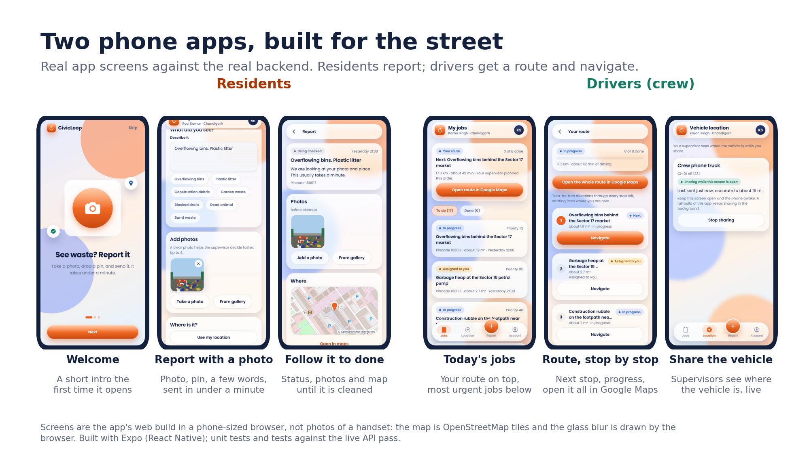

- **Design:** a glass-and-gradient look with Poppins type, custom dialogs (no system alerts), a custom spinner and pull-to-refresh,
  and custom error and not-found screens.
- **Navigation:** a pinned app bar (brand, screen title, name and city, profile button), a floating tab bar with filled icons and a
  raised "Report" button, and a swipeable first-launch **welcome** with Skip.
- **Resident app:** welcome, sign in or register (city and pincode), my reports, report waste (photo, pin, pincode), report detail
  with a map, account.
- **Crew app:** welcome, sign in, **today's jobs with the supervisor's route on top**, the route screen (ordered stops, progress,
  Navigate, open all in Google Maps), job detail with start and finish and proof photo, share the vehicle's location, report a site.
- **Safe to retry:** a report carries one idempotency key, so a slow network or a second tap never creates two reports.
- **Tests:** 15 unit tests for the client and helpers and 5 contract tests against the live API, with type checks on every package.
  Both apps bundle for Android, iOS and web.

**Not yet run on a real phone.** Background location with the screen off needs a development build, and the apps have only been
exercised as web builds. See "What needs a development build" in [`mobile/README.md`](mobile/README.md).

## 9. Architecture

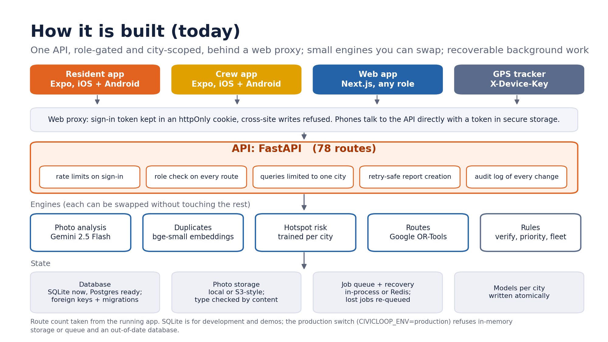

- **Web:** Next.js 16 (App Router), React 19, plain CSS. The map is a hand-built SVG slippy map on OpenStreetMap tiles, with a
  Google Maps embed for road routes. A route handler proxies `/api/v1` and keeps the token in an httpOnly cookie.
- **Phones:** Expo apps that talk to the API directly, with the token in the phone's secure storage.
- **API:** FastAPI. Every route is role-checked and every database query is limited to the caller's city.
- **Engines:** small, replaceable modules: photo analysis (`backend/civicloop/ai.py`), duplicates (`embeddings.py`), risk (`risk_model.py`),
  routing (`engines/routing.py`), rules (verification, priority, fleet).
- **State:** SQLAlchemy models with foreign keys enforced, Alembic migrations, pluggable photo storage and job queue.
- **Background work:** AI analysis runs off the request path, in-process by default or on Redis with a separate worker. A
  recovery pass re-queues jobs a crash left behind.

## 10. Many cities, one deployment

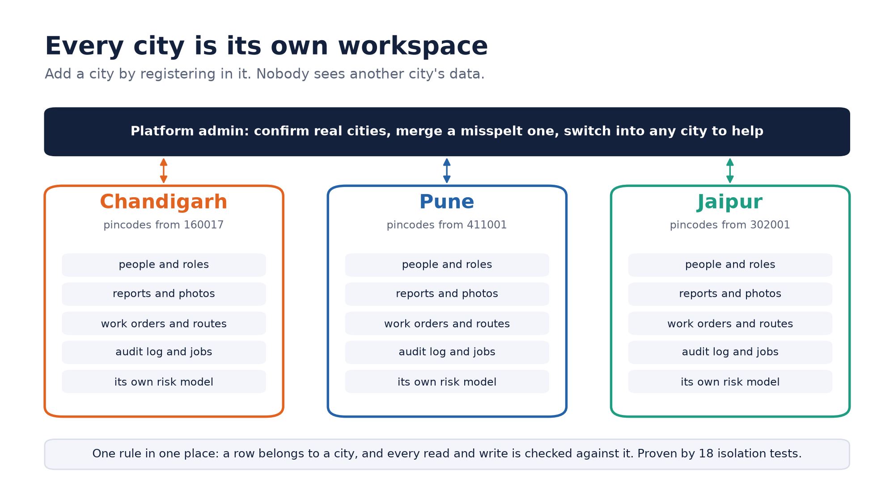

Every row belongs to a city. One rule in one place (`backend/civicloop/tenancy.py`) filters every read and stamps every write, so no
route has to remember it. A request can never see or change another city's data, and **a request session cannot lift its city
scope by accident** (cross-city routes use an explicit `lift_scope()`). Background jobs inherit the city of the report they work
on, each city trains and deploys its own risk model, and photos are stored under a per-city prefix.

- **Registration** takes a city and a six-digit pincode. A city that does not exist yet is created, **unconfirmed**.
- **Unconfirmed cities** work normally but are kept out of the public suggestions until a platform admin confirms them or merges
  a misspelling into the right one. A city must be **switched off before it can be merged**.
- **Platform admins** get a Cities page and a "Working in" switcher. A city always keeps at least one active administrator.
- The isolation is covered by dedicated tests (`backend/tests/test_tenancy.py`, `backend/tests/test_driver_routes.py`).

## 11. Security and reliability

A written failure-mode analysis (FMEA) of the whole codebase found 37 ways the system could fail, scored by severity,
likelihood and how late we would notice. The fixes are made and tested. The full table, the per-endpoint edge cases and what is
still open are in [`docs/FMEA.md`](docs/FMEA.md).

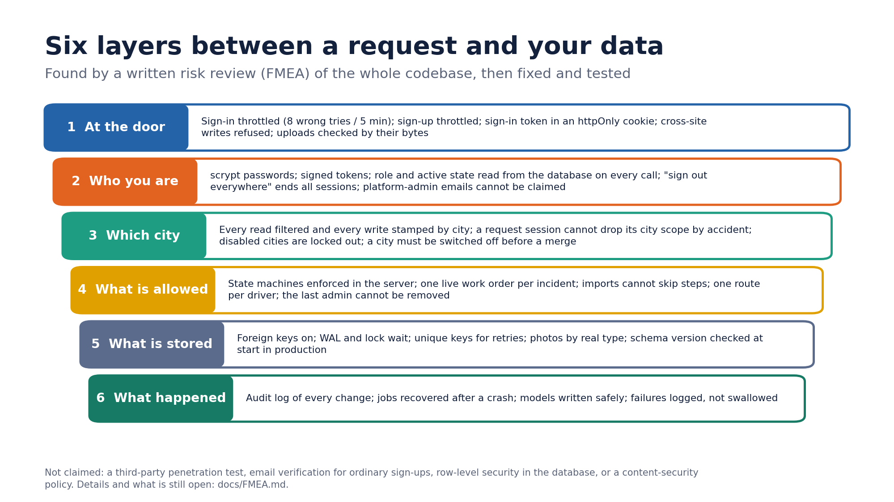

| Layer | What it does |
| --- | --- |
| **At the door** | Sign-in throttled (8 wrong tries per 5 minutes) and sign-up throttled; the web token lives in an httpOnly cookie; cross-site writes refused; uploads checked by their first bytes (JPEG, PNG, WebP, HEIC), 10 MB and 8 photos per report; a tracker is rate-limited per vehicle |
| **Who you are** | scrypt passwords; signed tokens; role and active state read from the database on every call; `POST /auth/logout-all` ends every session; platform-admin emails cannot be claimed by sign-up |
| **Which city** | Every read filtered and every write stamped by city; the scope cannot be dropped by accident |
| **What is allowed** | State machines in the server; one live work order per incident; imports cannot skip steps; one route per driver; the last admin cannot be removed |
| **What is stored** | On PostgreSQL (Supabase) every table has row-level security switched on with no policies and no access for the hosted API roles; foreign keys, write-ahead log and lock wait on SQLite; unique keys make retries safe (`Idempotency-Key` on report creation); the schema version is checked at start in production |
| **What happened** | Audit log of every change; jobs stuck or lost after a crash are recovered; models are written atomically; failures are logged, not swallowed |

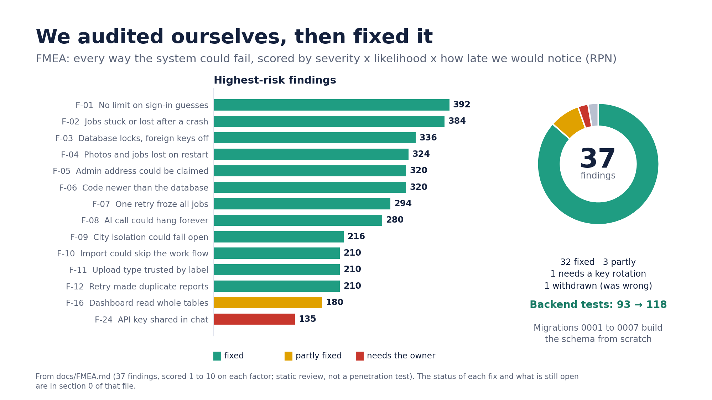

**Not claimed:** a third-party penetration test, email verification for ordinary sign-ups, database row-level security, a
content-security policy, or load testing. The Gemini API key that was once shared in a chat must be **rotated**.

## 12. AI and machine learning, and how good it really is

| Component | Method | Measured on | Result |
| --- | --- | --- | --- |
| Photo analysis | Gemini 2.5 Flash, zero-shot | **Nothing.** No labelled photos exist. | Unknown |
| Hotspot risk | Logistic regression or boosted trees; deployed only if it beats the formula by 0.01 AUC | 10 **simulated** cities, newest 30% held out | AUC 0.65 (formula) to 0.67 (model); clearly better in 5 of 10 |
| Duplicate reports | `bge-small-en-v1.5` sentence embeddings | 40 **hand-written** description pairs | AUC 0.89 vs 0.49 for word overlap; recall 95%, precision 70% |
| Routes | Google OR-Tools, guided local search | 12 random layouts per size vs nearest-stop-next | 8% to 16% shorter, urgent stops reached earlier |

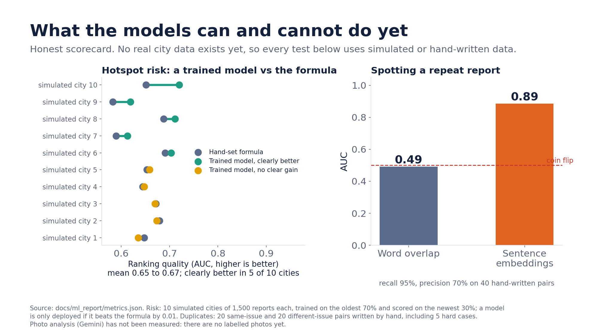

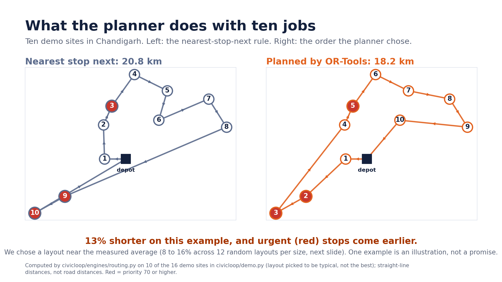

**There is no real dataset yet.** Every number above comes from simulated or hand-written data, and the interface labels simulated
history as simulated. Route savings are straight-line distances on random layouts, not real roads. The example slide above uses a
layout chosen to be close to the measured average, and says so.

Read the full method, figures and caveats in [`docs/ml_report/`](docs/ml_report/README.md). Regenerate with `python scripts/ml_report.py`.

## 13. Live vehicle tracking

Where each collection vehicle is, from a crew phone or a hardware GPS tracker.

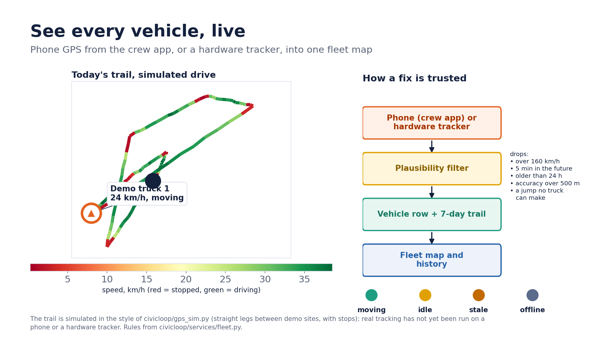

**Status:** built end to end. The API and plausibility checks are covered by `backend/tests/test_fleet.py`, the pages by the browser suite.

- **Live fleet page** (`/fleet`, supervisors and admins): every vehicle on a map, a list sorted by state, and a summary (moving,
  stopped, weak or offline, km today). Click a vehicle to centre on it, see its last hour as a trail, change its driver, switch it
  off, or replace its tracker key. The marker's shape, not only its colour, tells the state. Refreshes every 5 seconds.
- **Share my location** (crew): the driver shares their phone's GPS as their vehicle's position every 5 seconds.
- **Two ways in:** a crew phone posts as the signed-in driver (`POST /vehicles/{id}/position`); a GPS tracker posts with its key,
  no login (`POST /telemetry/gps` with `X-Device-Key`), one fix or a batch of up to 200.
- **Plausibility checks:** a fix is dropped if it is outside valid coordinates, more than 5 minutes in the future, older than 24
  hours, too vague (over 500 m), or implies over 160 km/h between two fixes.
- **State** is worked out on the server: `moving`, `idle`, `stale`, `offline`, `no_signal`. History keeps 7 days.
- **Keys** are stored as hashes, shown once and revocable. A vehicle's position update takes a row lock so a phone and a tracker
  cannot corrupt each other's distance count. A tracker is limited to 240 requests a minute.
- **Demo simulator:** `uv run python -m civicloop.gps_sim --email <supervisor> --password <pw> --vehicles 4` drives demo trucks between
  sites through the real tracker endpoint (straight lines, not roads).
- **One source per vehicle.** If a phone and a tracker report the same vehicle from different places, the server sees impossible
  jumps and drops the later one.

```bash
curl -X POST http://127.0.0.1:8000/api/v1/telemetry/gps \
  -H "X-Device-Key: clv_..." -H "Content-Type: application/json" \
  -d '{"lat": 30.7333, "lon": 76.7794, "speed_kmh": 24, "heading": 90, "recorded_at": "2026-10-23T09:30:00+00:00"}'
```

## 14. API map

Interactive docs are served by FastAPI at `/docs`. Everything is under `/api/v1`.

| Area | Routes (examples) |
| --- | --- |
| Auth and identity | `POST /auth/register`, `POST /auth/login`, `POST /auth/logout-all`, `GET /auth/me`, `GET /tenants?q=`, `GET /me/badges` |
| Incidents | `POST/GET /incidents` (`Idempotency-Key` header), `GET /incidents/{id}`, `PATCH /incidents/{id}/status`, `POST/GET /incidents/{id}/media` |
| AI and risk | `POST /incidents/{id}/analysis`, `GET/POST /incidents/{id}/risk`, `GET /ml/status`, `POST /ml/risk/train` |
| Review | `GET /queue`, `GET /incidents/{id}/timeline`, `.../duplicates`, `.../override`, `.../sensors` |
| Work | `POST /incidents/{id}/work-orders`, `GET /work-orders`, `POST /work-orders/{id}/approve\|assign\|start\|complete` |
| Routes | `POST /routes/preview`, `POST /routes`, `GET /routes`, `GET /routes/mine` (drivers), `GET /routes/{id}`, `POST /routes/{id}/approve` |
| Verification | `POST /incidents/{id}/verification`, `POST /verification/{id}/review` |
| Dashboard | `GET /dashboard/summary`, `GET /dashboard/map` |
| Fleet | `GET/POST /vehicles`, `PATCH /vehicles/{id}`, `POST /vehicles/{id}/device-key`, `GET /vehicles/{id}/trail`, `GET /vehicles/mine`, `POST /vehicles/{id}/position`, `POST /telemetry/gps` |
| Integrations | `POST /municipal/export\|import`, `GET/POST /sensors/readings`, `/evaluations`, `/pilots` |
| Admin | `GET/PATCH /users`, `GET /audit`, `GET /jobs`, `/platform/cities` (platform admins) |

## 15. Testing

```bash
cd backend && uv run pytest -q    # 123 backend tests (see below)
cd ..
cd frontend
npm run lint && npx tsc --noEmit
npm run e2e                        # Playwright journey across all roles; see the note below
cd ../mobile
npm test                           # 15 unit tests, plus 5 contract tests when CIVICLOOP_CONTRACT_URL points at a backend
npm run typecheck
```

| Layer | What is covered |
| --- | --- |
| Backend (123) | Auth and roles, the cleanup loop, ML, dashboard, tenancy, fleet, **driver routes** (7), and **hardening** (27): throttling, token revocation, reserved admin emails, production guards, job recovery, SQLite settings, tenant scope, import rules, one live order per incident, upload checks, retry-safe reports, bounded inputs, tracker rate limit, and that the migrations build a database the code accepts |
| Phone apps | Unit tests for the client and helpers; contract tests against a live backend; Android, iOS and web bundles |
| Browser | Signs in as every role, walks the cleanup loop on a throwaway backend, checks every page for horizontal scroll on a phone, and fails on console or server errors |

**Honest browser status:** the latest full run passed 112 checks and failed 6 older scripted flows that were written before the
one-route-per-driver rule (they route unassigned jobs and use the old button labels). They need updating; the pages they test
work. The steps that call Gemini fail when the API quota is exhausted, and the suite expects `BEFORE_PNG` and `AFTER_PNG` sample photos.

Regenerate screenshots with `node e2e/screenshots.mjs ../docs/screenshots`.

## 16. Project layout

```
backend/                   the API, deployable on its own (see backend/README.md)
  civicloop/               application package
    api.py                 app factory, auth, throttling, registration, incidents, media
    routes_ops.py          role-gated operations routes (work orders, routes, review, dashboard, admin, platform)
    routes_fleet.py        live vehicle tracking routes (supervisor, crew phone, GPS tracker)
    tenancy.py             per-city read filter, write stamping, lift_scope
    auth.py  images.py  db.py  models.py  repositories.py
    services/              one service per domain (incident, work_order, route_planning, fleet, dashboard, ...)
    engines/               deterministic engines: routing (OR-Tools + greedy), duplicates, risk formula
    ai.py  embeddings.py  risk_model.py  synthetic.py  ml_tools.py
    jobs.py  worker.py  job_handlers.py     background queue, worker and crash recovery
    make_admin.py          create the first administrator
    demo.py  gps_sim.py    demo data and the GPS simulator
  migrations/              Alembic revisions 0001 to 0007
  tests/                   pytest suite (123 tests)
  pyproject.toml  uv.lock  requirements.txt  alembic.ini  .env.example  .python-version
frontend/                  Next.js app (src/app pages, api/v1 proxy route, src/components incl. map/, src/lib, e2e/)
mobile/                    Expo apps: apps/resident, apps/crew, shared packages/ (core, ui, features)
scripts/                   ml_report.py, pitch_figures*.py, pitch2_figures.py, record_demo.py
docs/                      FMEA, ML report, screenshots, mobile screens, pitch (v1) and pitch2 (v2) slides
```

## 17. Honest status and limits

- **No real-world data yet.** All model results are simulated or hand-written. Gemini photo analysis is unmeasured.
- **Never run on a real phone.** The apps have been exercised as web builds. Background GPS, the camera and native maps are untested on hardware.
- **No load test and no outside security test.** Several earlier findings are only partly fixed: the dashboard still builds its numbers in Python, and a photo is held in memory (10 MB limit) while it uploads.
- **The after-photo check is file-based.** It does not look at the image or its location.
- **Routes use straight-line distance**, not road distance or live traffic. (Drivers get real road directions by opening the route in Google Maps.)
- **The driver's phone app shows the route as a list**, not a map, and the fleet map does not yet draw each vehicle's planned route.
- **No hardware integrations beyond GPS.** No RFID, bin sensors or weighbridge.
- **Municipal integration is manual:** export and import, not a live link to a city's system.
- **English only.** No Hindi or other languages yet. No offline mode.
- **Sign-up emails are not verified.** The first person to register a new city becomes its admin; a platform admin confirms real cities.
- **Six older browser flows need updating** (see [section 15](#15-testing)).
- **Free third-party limits:** Gemini has a quota; OpenStreetMap tiles are for light use and need a proper tile provider at scale.
- **No licence has been chosen.**

## 18. Roadmap

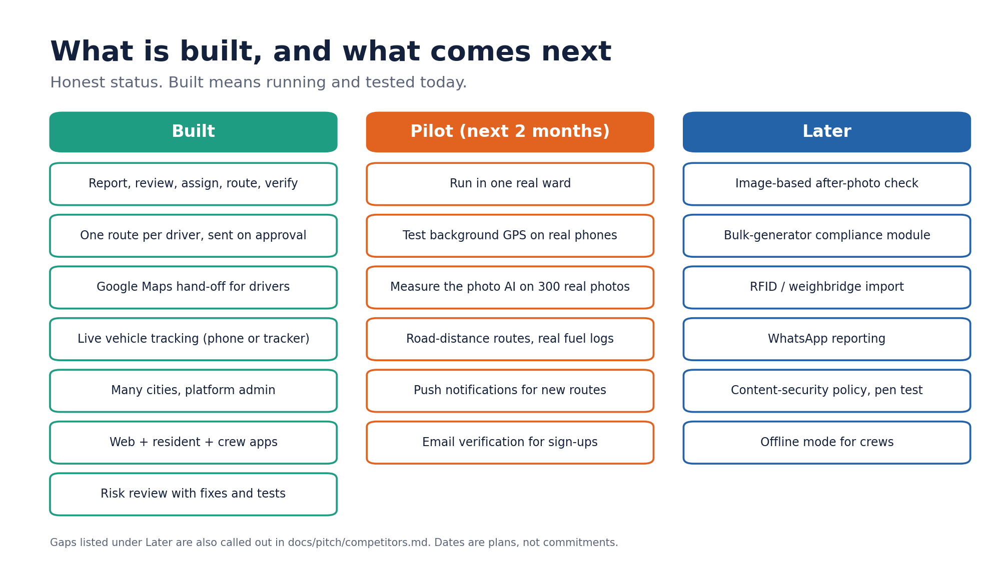

1. Run an 8-week pilot in one ward and measure time-to-clear and repeat-site rate on real reports.
2. Test on real phones, including background location, and update the older browser flows.
3. Show each truck against its planned route on a map, and alert when a vehicle is off route or stopped too long.
4. Location-based closure: match the after-photo to the report's place, then an image-based cleanup check.
5. Hand-label about 300 photos to measure the AI honestly; retrain the risk model on real history.
6. Accept a GPS feed from a city's existing tracking vendor; road-distance routing.
7. Bulk-generator compliance features; email verification, a content-security policy and an outside security test.

## 19. Docs, research and pitch material

| Where | What |
| --- | --- |
| [`docs/pitch2/`](docs/pitch2/) | **Pitch 2.0:** 25 slides: cover, journey, swim-lane flow chart, status trails, driver route rule, route example and results, live tracking, architecture, security layers, roles, mobile and web tours, reliability, scoreboard, humans and AI, model scorecard, market, pricing, pilot plan, roadmap, go-to-market, the ask, competitors |
| [`docs/pitch/`](docs/pitch/README.md) | The original eleven slides with talking points and sources |
| [`docs/pitch/market-and-pricing.md`](docs/pitch/market-and-pricing.md) | Market research, feasibility ranking, B2B vs B2G, subscription pricing and why |
| [`docs/pitch/competitors.md`](docs/pitch/competitors.md) | Who else is in this space, threat ranking, our gaps |
| [`docs/FMEA.md`](docs/FMEA.md) | The failure-mode analysis, the fix status of every finding, and per-endpoint edge cases |
| [`docs/ml_report/`](docs/ml_report/README.md) | Models, datasets, accuracy, figures, caveats |
| [`docs/screenshots/`](docs/screenshots/README.md), [`docs/mobile/`](docs/mobile/README.md) | Every page and role; every phone screen |
| `plan.md`, `route_plan.md`, `service.md`, ... | Original design notes |

Headlines from the research: collection is largely solved on paper (92% nationally) but processing is not (54%), and
Chandigarh reports collecting everything yet processing about 15% (CPCB 2021-22). The recommended path is B2B first (contractors
and bulk-waste-generator compliance), with a no-fee city pilot as proof. A city licence of Rs 1 lakh plus Rs 250 per vehicle per
month is estimated to pay for itself at a 1 to 2% saving. These are estimates on stated assumptions; read the documents before
quoting any of them. Regenerate the slides with `python scripts/pitch_figures.py`, `python scripts/pitch_figures_market.py`
and `python scripts/pitch2_figures.py <screenshot-folder>`.

## 20. Recording the demo video

`scripts/record_demo.py` drives the whole product headlessly with Playwright and records it, with captions and a visible cursor:
a resident reports waste, a supervisor reviews, assigns, plans and sends a route, the driver sees it, and both phone apps run.

```bash
pip install playwright && playwright install chromium
python scripts/record_demo.py                 # needs the backend (seeded) and the web app running
python scripts/record_demo.py --no-mobile     # web only
python scripts/record_demo.py --speed 1.5     # slower and calmer
```

It writes one `.webm` per scene to `demo_recording/` and, if `ffmpeg` is installed, joins them into `demo.mp4`. A scene that
cannot finish is skipped with a message so a partial demo is still produced. See the top of the script for the accounts and addresses it uses.

## 21. Troubleshooting

| Symptom | Fix |
| --- | --- |
| `no such column ...` after pulling new code | The database is older than the code. Run `uv run alembic upgrade head`, or delete a development database. Production refuses to start in this state. |
| API refuses to start in production | It needs `CIVICLOOP_AUTH_SECRET`, a non-memory storage and queue backend, and an up-to-date database (see [section 7](#7-configuration)). |
| 429 "Too many attempts" on sign-in | Wrong passwords were tried too often. Wait a few minutes, or raise `CIVICLOOP_LOGIN_ATTEMPTS` for a test run. |
| "This address is reserved" when registering an admin | That email is in `CIVICLOOP_PLATFORM_ADMINS`. Create it with `uv run python -m civicloop.make_admin`. |
| Phone app cannot reach the server | Same Wi-Fi, backend started with `--host 0.0.0.0`, port 8000 open in the firewall, and the address typed on the sign-in screen. |
| Route planner says "No assigned jobs are waiting" | Routes only group jobs already assigned to a driver. Assign approved work orders first. |
| AI analysis returns 502 or is disabled | Check `CIVICLOOP_AI_PROVIDER` and `GEMINI_API_KEY`, and the Gemini quota. The rest of the app works without it. |
| Photo upload rejected | Only JPEG, PNG, WebP and HEIC photos are accepted, up to 10 MB, 8 per report. |
| Embeddings warning at start | `fastembed` is not installed, so duplicate detection falls back to word overlap (it says which it used). Install the `ml` extra. |

---

<div align="center">

Built for the Chandigarh pilot. **Suggests, never decides.**

</div>
