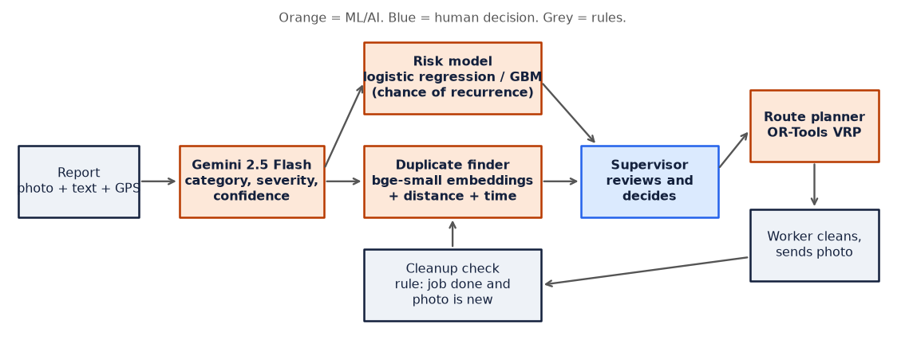
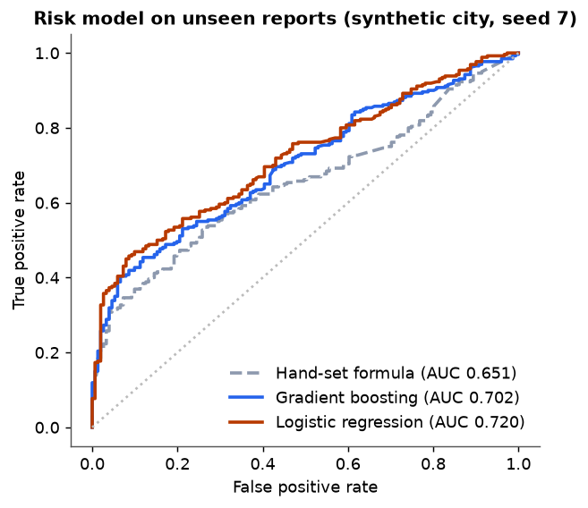
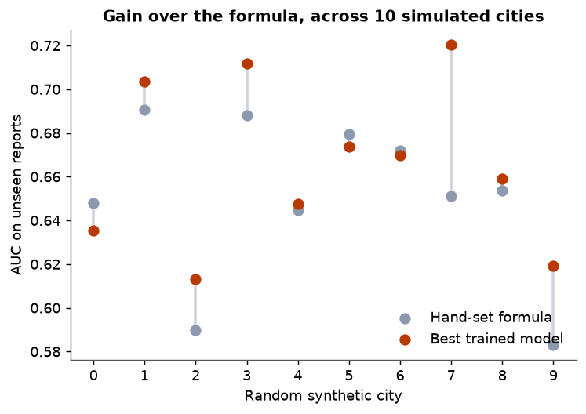
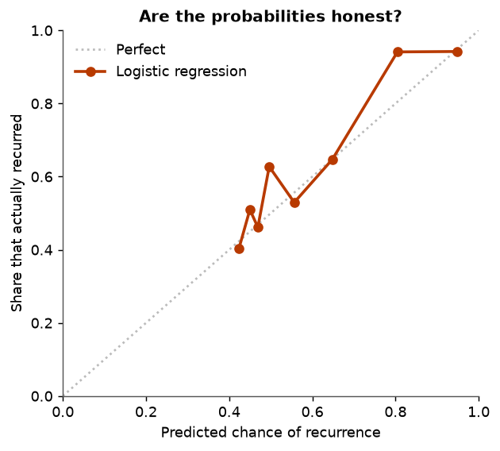
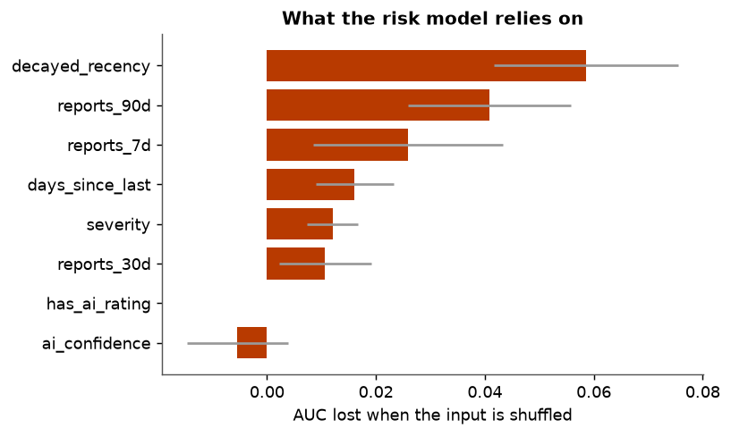
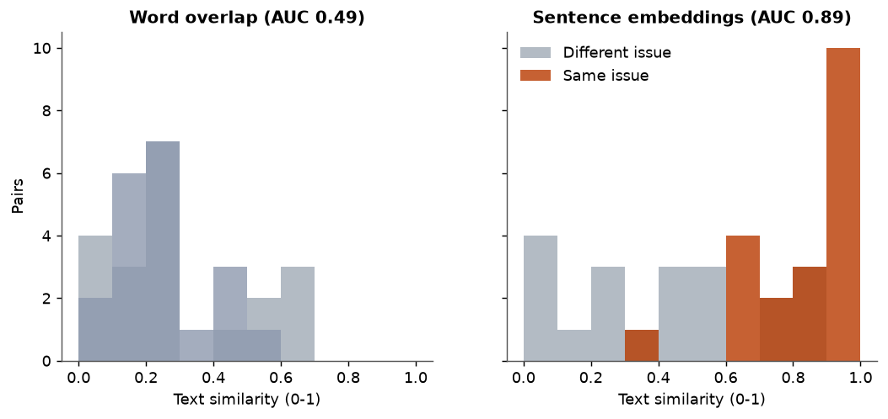
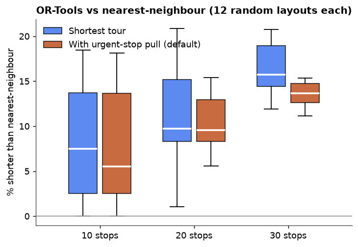
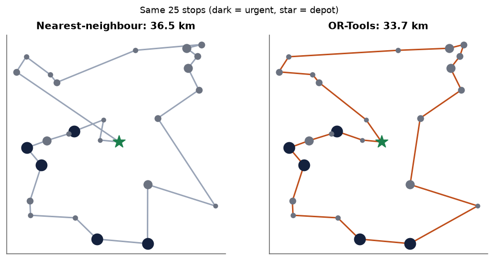

# CivicLoop ML evaluation

Regenerate everything with `python scripts/ml_report.py`. Numbers are in `metrics.json`.

## What is used, and what it was measured on

| Component | Model / method | Trained on | Measured on | Result |
| --- | --- | --- | --- | --- |
| Photo analysis | Gemini 2.5 Flash, zero-shot prompt | Google's own data (not ours) | **Not measured.** There are no labelled photos. | Unknown |
| Hotspot risk | Logistic regression or gradient boosting (best of the two on validation), predicts chance of a new report within 500 m in 30 days | **Synthetic** city, 1,500 reports | Newest 30% of the same synthetic city | See below |
| Duplicate text match | BAAI/bge-small-en-v1.5 sentence embeddings (quantised ONNX), not fine-tuned | BAAI's public corpora | 40 description pairs written by hand | See below |
| Routes | Google OR-Tools, guided local search, seeded with nearest-neighbour | none (optimisation) | Random stop layouts | See below |
| Cleanup check | Rule: job done and after-photo differs from before-photo | none | not measured | A real image check is not built |

**There is no real dataset yet.** Everything trained or tested here is simulated or hand-written. The synthetic generator (`civicloop/synthetic.py`) simulates 120 hotspots with bursty, heavy-tailed recurrence over a year.

## Risk model

 

 

Across 10 random synthetic cities (chronological split, newest 30% held out):

- Hand-set formula: AUC **0.650** (sd 0.036)
- Best trained model: AUC **0.665** (sd 0.036)
- Mean gain **+0.015**, range **-0.013 to +0.069**. The model beats the formula by 0.01 or more in only **5 of 10** cities.
- The earlier single-city result (0.707 vs 0.648) was one of the favourable cities.
- "Best trained model" picks the winner of two models on the same held-out data, so its average is slightly optimistic.
- An AUC of 0.65 to 0.70 is a weak-to-moderate ranker. Recurrence in the simulated world is mostly noise by design.

What this does show: the pipeline is leak-free (features look only at earlier reports, `still open` is excluded), validates chronologically, and refuses to deploy a model that does not beat the formula. What it does not show: how well it will work on real Chandigarh data.

## Duplicate detection (description text only)

| 20 same-issue + 20 different-issue pairs | AUC | Precision | Recall |
| --- | --- | --- | --- |
| Word overlap (threshold 0.30) | 0.49 | 0.60 | 0.45 |
| Sentence embeddings (threshold 0.50) | 0.89 | 0.70 | 0.95 |

Word overlap is no better than a coin flip on paraphrases. Embeddings are far better but still confuse hard cases such as "garbage near the school" and "garbage near the hospital". The full duplicate score also uses distance (250 m), time (24 h) and AI category, which this test does not cover. 40 pairs written by one person is indicative, not a benchmark.

## Route planning

Mean route length vs nearest-neighbour, 12 random layouts per size, straight-line distances:

| Stops | Shortest tour | With urgent-stop pull (default) | Position of urgent stops (0 = first, 1 = last) |
| --- | --- | --- | --- |
| 10 | 8.2% shorter | 7.8% shorter | 0.53 -> 0.37 |
| 20 | 11.1% shorter | 10.3% shorter | 0.53 -> 0.39 |
| 30 | 15.7% shorter | 13.1% shorter | 0.52 -> 0.36 |

Solve time is about 2 seconds per route (the time limit). Distances are straight-line, not road distances.

## Not covered

- **Gemini accuracy**: needs a labelled photo set (category and severity) and a plan for measuring it.
- **Real-data risk accuracy**: needs months of real reports.
- **Cleanup verification**: currently a rule, not an image model.
